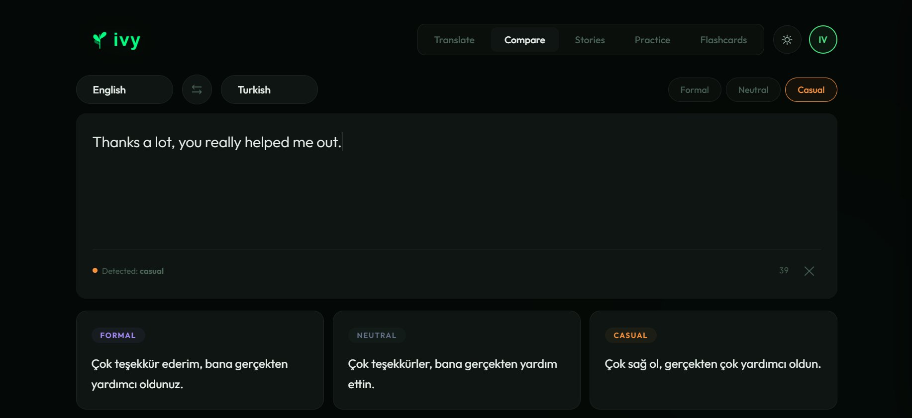
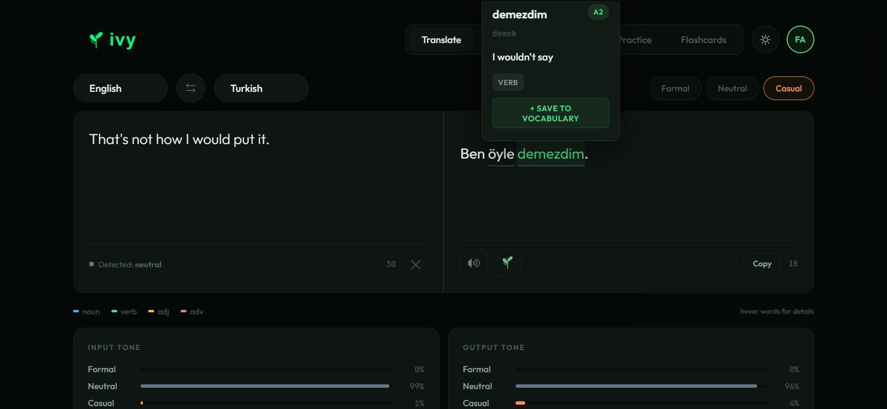
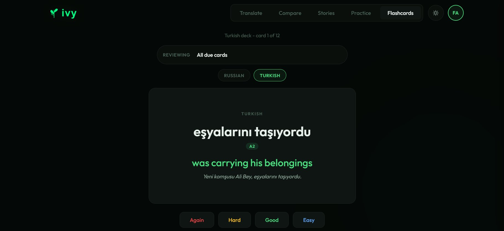
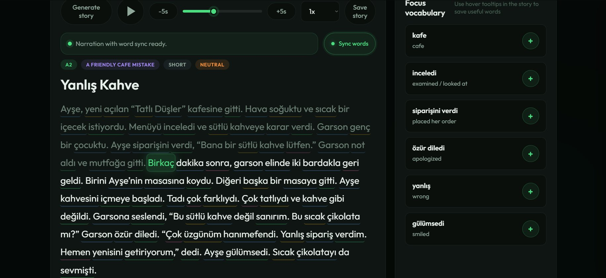

<div align="center">

# Ivy

**A style-aware multilingual translator for language learners.**

Translate between English, Turkish, German, and Russian in three registers — formal, neutral, or casual — with built-in vocabulary saving, spaced-repetition flashcards, and AI-generated graded reading material with synchronised audio.

</div>

<p align="center">
  
</p>

---

## What is Ivy?

Most translators give you one answer. Type a sentence in, get a sentence out — and the answer is grammatically correct but socially flat. The way you'd ask a stranger for the time in Turkish is not the way you'd ask a close friend, and the same is true in Russian, German, and most living languages. Mainstream translators treat that choice as already made for you. Ivy doesn't.

Ivy is a small but complete language-learning environment built around a translator that *takes register as an input*. You pick formal, neutral, or casual; the system delivers a translation appropriate to that register, and a multilingual style classifier verifies what it actually produced. Around the translator sits the rest of what a learner actually needs: every word in every translation is analysed for part of speech, base form, and grammatical metadata; vocabulary saves with one click; flashcards schedule themselves via SuperMemo SM-2; short stories generate on demand at chosen CEFR levels with synchronised text-to-speech playback; and flashcard sets can be shared with other users through a snapshot-fork community layer.

This was built as a capstone project at İstinye University. The full technical report — including evaluation methodology, results, and an honest discussion of limitations — is in [`docs/report.pdf`](docs/report.pdf).

## Features

### Style-aware translation across four languages

<p align="center">
  
</p>

Pick a source language, a target language, and a register. The pipeline combines Helsinki-NLP's [opus-mt-tc-big](https://huggingface.co/Helsinki-NLP) models for the base translation with [Google Gemini 2.5 Flash](https://ai.google.dev) for register restyling. For non-English pairs (e.g., Russian → Turkish) it chains through English when no direct model exists. Specifically for casual Turkish, a two-layer correction mechanism handles the persistent failure mode of LLMs retaining the formal copular suffix `-dır` in informal contexts.

Compare mode renders all three registers side-by-side from a single input — useful for learners who want to see *why* each register sounds the way it does.

### Word-level analysis with inline tooltips

<p align="center">
  
</p>

Every translated word is automatically analysed: part of speech, base form, grammatical case and gender where applicable, and an estimated CEFR difficulty. Hover any word to see the analysis; one click saves it to your vocabulary. Color-coded underlines (noun blue, verb green, adjective yellow, adverb pink) make the grammatical structure visible at a glance. The bottom panels show the input-tone and output-tone analysis from the style classifier.

### Spaced-repetition flashcards (SM-2)

<p align="center">
  
</p>

Saved vocabulary becomes flashcards automatically. The scheduler implements the SuperMemo SM-2 algorithm — the same one Anki uses — so cards you struggle with come back sooner and cards you find easy slide further into the future. Cards show the target-language word, the example sentence it came from, the CEFR level, and the English translation. Sets are personal by default; you can mark any set public for the community.

### AI-generated stories with karaoke audio

<p align="center">
  
</p>

Generate a short story in your target language at a CEFR level you choose, on a topic you choose. The story is read aloud by Google Cloud's Chirp 3 HD voices with word-level synchronisation, so the currently-spoken word is highlighted as it plays. Click any word to look it up or save it without losing your place. The right panel surfaces a focus-vocabulary list pulled from the story.

### Community: friends and snapshot-fork sets

Add friends by email. Browse and adopt public flashcard sets — adoption creates a deep copy of the set with fresh SM-2 progress, so your study state and the original author's stay completely independent.

## Languages and registers supported

|              | English | Turkish | German | Russian |
|--------------|:-------:|:-------:|:------:|:-------:|
| **Formal**   |   ✅    |   ✅    |   ✅   |   ✅    |
| **Neutral**  |   ✅    |   ✅    |   ✅   |   ✅    |
| **Casual**   |   ✅    |   ✅    |   ✅   |   ✅    |

All twelve cross-language directions are supported (e.g., en ↔ tr, tr ↔ de). Pairs without a direct opus-mt model chain through English transparently.

## Tech stack

**Backend:** Python 3.10+, Flask, SQLite, Flask-Login, bcrypt
**ML / NLP:** Hugging Face Transformers, Helsinki-NLP opus-mt-tc-big, mBERT (multilingual BERT) for the style classifier
**LLM:** Google Gemini 2.5 Flash for register restyling, word analysis, and story generation
**TTS:** Google Cloud Text-to-Speech (Chirp 3 HD)
**Frontend:** Vanilla JavaScript SPA, Jinja2 templates, Chart.js for the radar visualisation

## Installation

### Prerequisites

- Python 3.10 or newer
- ~5 GB of disk space (for the opus-mt model weights, downloaded on first run)
- A Google AI Studio account with Gemini API access ([free tier works for most usage](https://ai.google.dev/pricing))
- A Google Cloud project with the Text-to-Speech API enabled ([free monthly quota covers typical usage](https://cloud.google.com/text-to-speech/pricing))

### Setup

```bash
# Clone
git clone https://github.com/ifnotzaid/style-translator.git
cd style-translator

# Create a virtual environment (recommended)
python -m venv .venv
source .venv/bin/activate   # on Windows: .venv\Scripts\activate

# Install dependencies
pip install -r requirements.txt
```

The first time you run the app, it will download the opus-mt model checkpoints (~3 GB total across the six language pairs). This is a one-time cost; subsequent starts are fast.

### Configuration

Create a `.env` file in the project root (a `.env.example` is provided):

```bash
# Gemini API key from https://aistudio.google.com/apikey
GEMINI_API_KEY=your_gemini_key_here

# Path to your Google Cloud service-account JSON for Text-to-Speech
GOOGLE_APPLICATION_CREDENTIALS=./google-cloud-credentials.json

# Flask session secret (generate with: python -c "import secrets; print(secrets.token_hex(32))")
FLASK_SECRET_KEY=your_random_secret_here
```

The `.env` file is gitignored. Never commit your keys.

## Running

```bash
python app/app.py
```

By default, Ivy listens on `http://localhost:5000`. Open that in your browser, create an account, and start translating.

On first startup, expect a 30-60 second wait while the opus-mt and BERT models load into memory. Subsequent translation requests are fast (typically 1-3 seconds, mostly Gemini API latency).

## Evaluation

A quantitative evaluation of all three system components is documented in the [final report](docs/report.pdf). Briefly:

| Component         | Metric           | Result                                          |
|-------------------|------------------|-------------------------------------------------|
| Translation       | BLEU / chrF++    | 44.85–62.78 / 62.53–72.92 across six directions |
| Style classifier  | Macro-F1         | 0.77 across 432 sentences in four languages     |
| Word analysis     | POS accuracy     | 98% on 100 Turkish entries                      |

The most interesting single result is the structure of the style classifier's confusion matrix: out of 288 truly extreme-register inputs (144 formal + 144 casual), the classifier never crosses the polarity line. Errors concentrate as drift toward the neutral class. The classifier knows where the poles are; it's just conservative about committing to non-neutral labels.

The evaluation harness is in `eval/` and can be rerun with:

```bash
python -m eval.run_all
```

## Project structure

```
style-translator/
├── app/                     # Flask app entry point and routes
│   ├── app.py               # Main application, translation/style endpoints
│   ├── auth_routes.py       # Authentication, vocabulary, flashcards, social
│   └── database.py          # SQLite data-access layer
├── templates/               # Jinja2 templates
│   ├── index.html           # Main SPA (translation, stories, flashcards)
│   └── sets.html            # Community flashcard sets page
├── eval/                    # Evaluation harness
│   ├── run_all.py           # Top-level evaluation driver
│   ├── data/                # Evaluation datasets (translation, style, word)
│   ├── runners/             # Per-task evaluation logic
│   └── build_*.py           # Scripts that build the eval data
├── data/
│   └── translator.db        # SQLite database (created on first run)
├── docs/
│   ├── report.pdf           # Capstone final report
│   └── screenshots/         # README screenshots
├── reports/
│   ├── evaluation_report.md
│   └── evaluation_report.json
├── requirements.txt
├── .env.example
└── README.md
```

## Limitations

Built into the project from the start and discussed honestly in the [final report](docs/report.pdf):

- **Translation evaluation does not directly test style targeting.** The Tatoeba-derived test set runs the pipeline in neutral mode, which collapses to the opus-mt backbone with no Gemini restyling. A proper style-aware test set with per-register references is the most important single piece of future work.
- **Style classifier evaluation uses LLM-generated test data.** The eval prompts differ from training prompts, but the underlying model family is the same. Fully independent evaluation would use human-authored test data.
- **Word-analysis evaluation is AI-on-AI.** Test labels are GPT-4-generated, so the reported numbers measure inter-model agreement rather than ground truth. About 11 of 13 "errors" are conventional disagreements (bare-stem lemma vs. infinitive lemma), not real errors.
- **English chaining is lossy.** Non-English-anchored pairs (e.g., ru → tr) translate through English and accumulate two stages of error.
- **The casual register doesn't apply to all content.** Aphoristic English inputs ("Money is the anthem of success") produce register-neutral Turkish output, because Turkish speakers don't aphorise casually. This is linguistically correct behaviour but can look like a failure.

## Acknowledgments

This project was built as the COE402 Capstone Project at İstinye University, Department of Software Engineering, under the supervision of Asst. Prof. Ragıp Mustafa Başbuğ.

Built on top of work by [Helsinki-NLP / OPUS](https://github.com/Helsinki-NLP/Opus-MT) (Tiedemann and collaborators), [Hugging Face Transformers](https://github.com/huggingface/transformers), [Google Gemini](https://ai.google.dev), [Google Cloud Text-to-Speech](https://cloud.google.com/text-to-speech), and the contributors to the [Tatoeba](https://tatoeba.org) and OPUS-100 parallel corpora. The SM-2 spaced-repetition algorithm is from Woźniak & Gorzelanczyk (1994).

## License

This project is released for academic and personal use. For commercial use, please open an issue.
