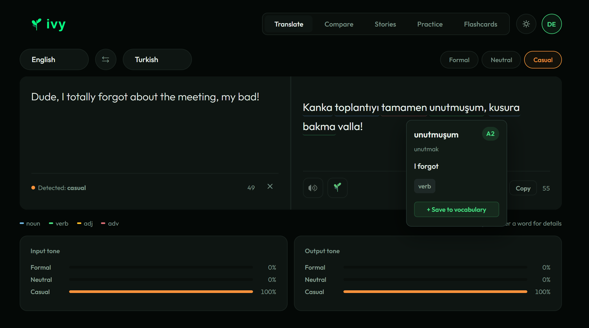
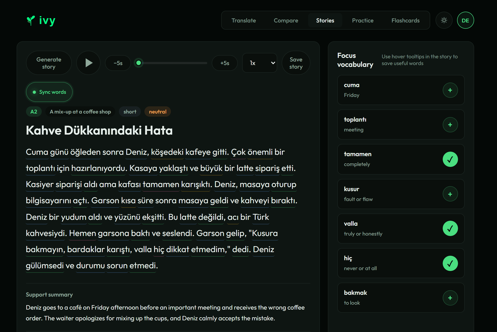
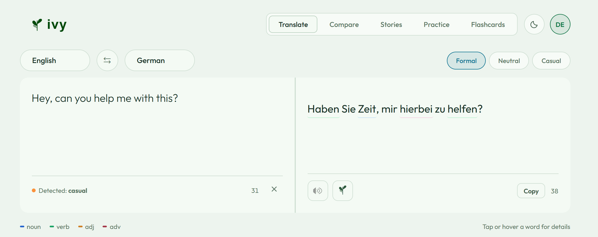
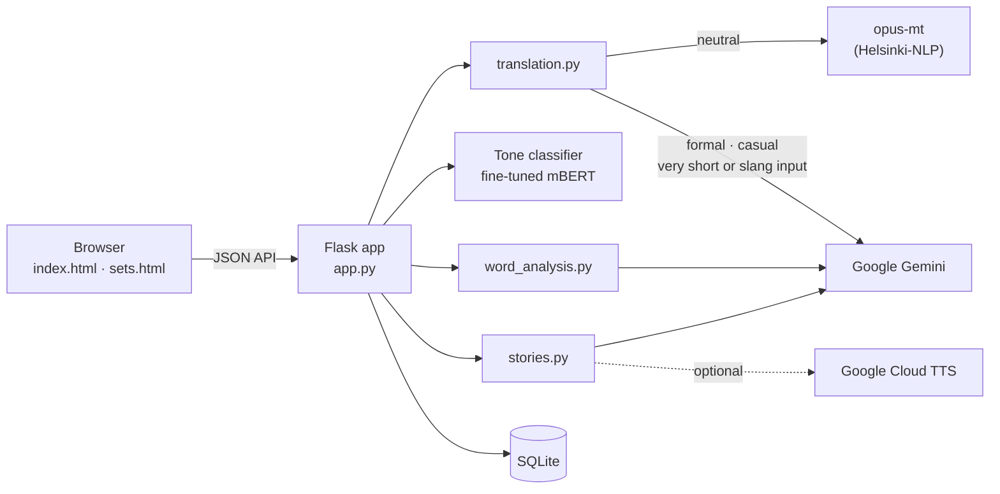

<div align="center">

<picture>
  <source media="(prefers-color-scheme: dark)" srcset="app/static/logo-dark.png" />
  
</picture>

**A style-aware translator for language learners.**

Translate between English, Turkish, German and Russian in a formal, neutral or casual register,
see what every word means, and turn the words you meet into flashcards, stories and practice.

Python · Flask · PyTorch / Hugging Face Transformers · Google Gemini · SQLite · vanilla JS

</div>

<p align="center">
  
</p>

## Why Ivy

Most translators give one answer, and that answer is usually polite and a little stiff. But
asking a stranger for the time in Turkish sounds nothing like asking a close friend. Learners
need to see that difference, and normal translators hide it.

Ivy takes the register as an input. You choose formal, neutral or casual and get a translation
written that way. A fine-tuned multilingual BERT classifier then scores the tone of the input and
the output, so you can check that the result sounds the way you asked. Everything else is built
for learning: tap any translated word for its meaning and grammar, save it, review it with
spaced repetition, read short stories at your CEFR level, and practise with gap-fill quizzes.

Ivy is my capstone project at İstinye University (Software Engineering). The full technical
report, with the evaluation method, results and limitations, is in [`docs/report.pdf`](docs/report.pdf).

## Features

### One sentence, three registers

<p align="center">
  
</p>

Compare mode translates one input into all three registers side by side, so the differences
(siz vs. sen, *-ebilir misiniz* vs. *-sene bi*) are easy to see.

### Word-by-word details

Every word in a translation is analysed for part of speech, base form, meaning, grammatical case
and gender where they apply, and an estimated CEFR level. Underlines are coloured by part of
speech (noun blue, verb green, adjective amber, adverb pink). Details open on hover, tap or
keyboard focus, and one click saves the word to your vocabulary.

### Spaced-repetition flashcards

<p align="center">
  
</p>

Saved words become flashcards, scheduled with the SuperMemo SM-2 algorithm (the one Anki is
based on). Each card keeps the sentence the word came from. Cards can be grouped into sets, and
sets can be made public.

### Stories at your level

<p align="center">
  
</p>

Generate a short story in your target language at a chosen CEFR level and theme, with a summary
in your own language, comprehension questions and a focus vocabulary list. Every word in the
story has the same details as translations. With Google Cloud Text-to-Speech set up, stories are
read aloud and the current word is highlighted as it is spoken.

### Practice and community

- **Practice:** gap-fill quizzes built from your saved words or stories.
- **Community:** add friends, browse public flashcard sets and adopt one. Adopting makes your
  own copy with fresh SM-2 progress, so your study history and the author's stay separate.
- **Ivy explains:** ask why a translation was worded the way it was.
- **Light and dark themes**, a phone layout, keyboard support and reduced-motion support.

<p align="center">
  
</p>

## How it works



- **Neutral** translations come from Helsinki-NLP opus-mt models running locally. Pairs without
  a direct model (for example Turkish → German) go through English. Very short inputs, slang
  and profanity, and inputs that opus-mt copies through unchanged ("cool" → "cool") go to Gemini
  instead.
- **Formal and casual** translations are written by Gemini with per-language register rules
  (for example *siz* vs. *sen* in Turkish, *Sie* vs. *du* in German, *вы* vs. *ты* in Russian).
  An extra pass removes the written-style Turkish *-dır* endings that LLMs tend to leave in casual
  text. Formal stays clean; neutral and casual translate swearing faithfully instead of
  softening or abbreviating it.
- **Tone bars** come from a multilingual BERT model I fine-tuned to label text as formal,
  neutral or casual (13,800 labelled sentences in four languages, 88.8% validation accuracy).
- **Fallbacks:** if Gemini is unavailable or its quota is used up, Ivy pauses AI calls for as
  long as Google asks, falls back to opus-mt and shows a quiet notice instead of failing.
- **Security:** everything from a user or an AI response is HTML-escaped before it is shown,
  because public sets are seen by other users. Passwords are hashed with bcrypt.

The backend is split by feature: `gemini.py` (the shared client, quota handling), `translation.py`,
`word_analysis.py`, `stories.py`, `tts.py`, `auth_routes.py` and `database.py`. The frontend is
plain HTML, CSS and JavaScript; its design rules are in [`DESIGN.md`](DESIGN.md).

## Languages

All twelve directions between English, Turkish, German and Russian, each in formal, neutral and
casual. Same-language input (for example English → English) rewrites the text in the chosen
register.

## Running it locally

**You need:** Python 3.10+, about 5 GB of disk space for the translation models, and a free
[Gemini API key](https://aistudio.google.com/apikey).

```bash
git clone https://github.com/ifnotzaid/Ivy.git
cd Ivy
python -m venv .venv
source .venv/bin/activate        # Windows: .venv\Scripts\activate
pip install -r requirements.txt
cp .env.example .env             # Windows: copy .env.example .env
```

Open `.env` and set `GEMINI_API_KEY` and `FLASK_SECRET_KEY`
(`python -c "import secrets; print(secrets.token_hex(32))"` makes a good one). Then:

```bash
python app/app.py
```

Open http://localhost:5000 and create an account. The first start downloads the opus-mt models
(about 3 GB) and takes a few minutes; later starts take 30–60 seconds. The startup summary says
whether Gemini and the classifier loaded.

**Optional settings**

- `GEMINI_MODEL`: which Gemini model to use (default `gemini-2.5-flash`). The free tier allows
  only 20 requests a day for that model; a lite model such as `gemini-3.5-flash-lite` has its
  own quota.
- **Tone classifier:** the trained weights (about 680 MB) are too large for git. Put them in
  `models/style-classifier-final/`. Without them Ivy still runs, and the tone bars show an even
  split. The training data is in `data/processed/classifier/` (multilingual BERT, 3 epochs,
  learning rate 2e-5, batch size 32; about 6 minutes on a Colab GPU).
- **Story audio:** set `GOOGLE_APPLICATION_CREDENTIALS` to a Google Cloud service-account key
  with the Text-to-Speech API enabled.

## Evaluation

The evaluation is described in full in the [report](docs/report.pdf). In short:

| Component        | Metric        | Result                                          |
|------------------|---------------|-------------------------------------------------|
| Translation      | BLEU / chrF++ | 44.85–62.78 / 62.53–72.92 across six directions |
| Style classifier | Macro-F1      | 0.77 on 432 sentences in four languages         |
| Word analysis    | POS accuracy  | 98% on 100 Turkish entries                      |

The most interesting result is the shape of the classifier's mistakes: out of 288 clearly formal
or clearly casual test sentences, it never labelled a formal one casual or a casual one formal.
Its errors are all drift toward neutral.

The evaluation harness is in `eval/` and can be rerun with `python -m eval.run_all`; the latest
results are in [`reports/evaluation_report.md`](reports/evaluation_report.md).

## Limitations

- **The translation test runs in neutral mode**, so it measures the opus-mt backbone, not the
  register rewriting. A test set with separate formal and casual references is the most useful
  next step.
- **The classifier test data is LLM-generated.** The prompts differ from the training prompts,
  but human-written test sentences would be a fairer test.
- **Word-analysis labels were generated by GPT-4**, so the score measures agreement between two
  models. Most of the 13 "errors" are lemma conventions (stem vs. infinitive), not real mistakes.
- **Going through English loses information** for pairs like Russian → Turkish.
- **Some sentences have no casual form.** Proverb-like English ("Money is the anthem of
  success") comes out the same in every register in Turkish, which is correct but can look like
  a failure.

## Project structure

```
Ivy/
├── app/
│   ├── app.py              # Flask app, translate / compare / story routes, startup
│   ├── gemini.py           # shared Gemini client, JSON parsing, quota handling
│   ├── translation.py      # opus-mt, register rules, tone classifier
│   ├── word_analysis.py    # per-word grammar and meaning
│   ├── stories.py          # CEFR story generation
│   ├── tts.py              # Google Cloud Text-to-Speech and word timing
│   ├── auth_routes.py      # accounts, vocabulary, flashcards, sets, friends, practice
│   ├── database.py         # SQLite data layer, SM-2 scheduling
│   ├── templates/          # index.html (the app), sets.html (community)
│   └── static/             # css/, js/, logos
├── data/processed/classifier/   # tone classifier training data
├── eval/                   # evaluation harness and test sets
├── reports/                # evaluation results
├── scripts/                # data download, generation and preprocessing
├── docs/                   # report.pdf, screenshots
├── DESIGN.md               # design system
└── requirements.txt
```

## Acknowledgements

Built as the COE402 Capstone Project at İstinye University, Department of Software Engineering,
supervised by Asst. Prof. Ragıp Mustafa Başbuğ.

Ivy builds on [Helsinki-NLP / OPUS-MT](https://github.com/Helsinki-NLP/Opus-MT),
[Hugging Face Transformers](https://github.com/huggingface/transformers),
[Google Gemini](https://ai.google.dev),
[Google Cloud Text-to-Speech](https://cloud.google.com/text-to-speech), and the
[Tatoeba](https://tatoeba.org) and OPUS-100 corpora. SM-2 is from Woźniak & Gorzelańczyk (1994).

## License

Released for academic and personal use. For commercial use, please open an issue.

Made by Zaid ([ifnotzaid](https://github.com/ifnotzaid)).
